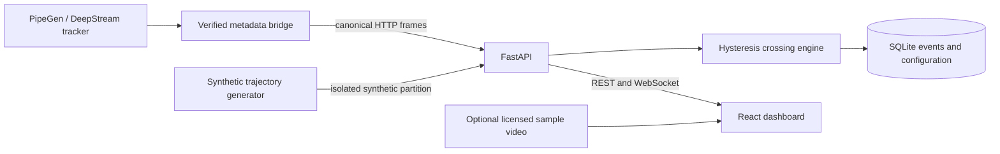

# TrafficFlow AI

React + TypeScript traffic operations dashboard and FastAPI/SQLite event service. Development simulation is explicitly labeled and partitioned from real data. No inference model is bundled. Real ingestion requires a verified PipeGen class mapping.

## Run locally

Requirements: Python 3.11+, Node 20.19+ and pnpm. From the project directory:

```bash
python3 -m venv .venv
.venv/bin/pip install -r backend/requirements.txt
cd frontend
pnpm install
pnpm build
cd ..
./scripts/run.sh
```

Open http://127.0.0.1:8002. API explorer: http://127.0.0.1:8002/docs. Keep the server bound to loopback; authentication and remote deployment are outside this local demo.

For frontend development, run backend as above and `pnpm dev` inside frontend; Vite proxies API and WebSocket to port 8002. If Node is not on PATH, use an existing installed runtime rather than modifying system packages.

## Demo

1. Open the dashboard and select **SYNTHETIC**. Moving tracks and events are generated by the backend; these are unrelated to the optional sample video.
2. Watch class counters, directional counts, activity chart and timestamped crossing timeline populate.
3. Edit a counting line, save it, reload and verify persistence. Each mode has its own line configuration and event partition.
4. Filter events by class/direction; export CSV/JSON through the dashboard or `/api/export?mode=synthetic&format=json`.
5. Switch to real mode: the dashboard waits for actual metadata. It does not manufacture real inference.

## Architecture



The backend converts source pixel boxes to normalized coordinates. The UI shares normalized geometry for video, boxes and virtual lines. Tensor letterbox/crop transforms must be applied in the metadata bridge using the genuine pipeline's preprocessing metadata.

## Verification

```bash
.venv/bin/python -m pytest backend/tests -q
cd frontend
pnpm build
```

See `docs/VERIFICATION.md` for executed results, `docs/PIPEGEN_HANDOFF.md` for the adapter contract and integration checklist, and `docs/VIDEO_PROVENANCE.md` for sample attribution. API schemas in `/docs` describe all validation rules. Runtime databases, dependencies and media are ignored by Git.

## Deployment boundaries

One local backend worker owns track state. Do not run multiple workers without shared trajectory state and ordered frame processing. Track resets, occlusions, ID changes and video/metadata synchronization require validation with the actual pipeline. GPU readiness is independent of this application's CPU-only dashboard tests.
