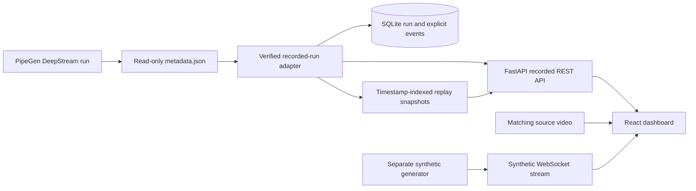

# TrafficFlow AI — verified PipeGen traffic analytics

TrafficFlow AI connects a completed PipeGen/DeepStream run to a React + TypeScript dashboard and FastAPI/SQLite backend. The supplied run uses YOLOv8m TensorRT FP16 on an RTX 3050 Laptop GPU. This submission presents **recorded real inference**, alongside an explicitly separate synthetic development mode.

## Final application

The current implementation is on [`feature/simulated-usb-camera`](https://github.com/vivekvijayababu/TrafficFlow-AI/tree/feature/simulated-usb-camera). It includes the genuine PipeGen integration, playback-synchronized camera demo, safe Recorded Video fallback, and the final **white interface with black text, blue chart accents and larger typography**. The latest visual update increased dashboard, control and chart text by 3 pixels while preserving functionality.

- **Primary demo:** a 30-second intersection MP4 replay at its original 30 FPS, explicitly labeled as recorded replay.
- **Progressive analytics:** source detections, bounding boxes, tracker IDs, class observations, directional crossings and event history follow playback time.
- **Playback controls:** start, pause, restart and seek without inserting or duplicating source events.
- **Stable fallback:** one-click Recorded Video retains full-run totals; replay errors automatically select it with an explanatory notice.
- **Exports:** class/direction filtering and CSV/JSON; replay exports include events reached at the selected timestamp.
- **Separate testing:** synthetic mode remains isolated from genuine recorded analytics.
- **Future hardware:** device availability checks only; no physical USB camera inference is claimed.

## Verified run results

| Metric | Result |
|---|---:|
| Source frames | 900 at 1280×720 |
| Raw object observations, including nontraffic classes | 7,857 |
| Traffic-class observations across frames | 6,651 |
| Unique tracker IDs, all classes | 130 |
| Unique tracker IDs, traffic classes | 122 |
| Pipeline-reported line crossings | 28 |
| Left to right / right to left | 24 / 4 |

| Traffic class | Frame observations | Unique track IDs | Crossings L→R | Crossings R→L |
|---|---:|---:|---:|---:|
| Car | 3,748 | 94 | 17 | 3 |
| Pedestrian (`person`) | 1,717 | 17 | 4 | 1 |
| Bicycle | 739 | 3 | 0 | 0 |
| Motorcycle | 188 | 4 | 3 | 0 |
| Truck | 259 | 4 | 0 | 0 |
| Bus | 0 | 0 | 0 | 0 |

Observations repeat across frames. Track IDs are tracker identities, not a guarantee of distinct physical road users. Crossings come from explicit `fields.event_N_*` records and are checked against cumulative counters; the adapter does not recompute or invent crossings.

The metadata has nanosecond presentation timestamps, frame IDs, source IDs, class IDs/labels, stable tracking IDs, confidence, bounding boxes, explicit event IDs, crossing track IDs, labels, directions and crossing points. It has no UTC/capture timestamp. The dashboard shows relative video time and identifies the source as a recorded run.

## Run locally

Requirements: Python 3.11+, Node 20.19+ and pnpm. No GPU is required to inspect the recorded run.

```bash
python3 -m venv .venv
.venv/bin/pip install -r backend/requirements.txt
cd frontend
pnpm install
pnpm build
cd ..
./scripts/run.sh
```

Open **http://127.0.0.1:8005**. The single backend serves the built frontend. API explorer: http://127.0.0.1:8005/docs.

The audited metadata snapshot in `evidence/pipegen/metadata.json` makes the recorded run reproducible without private directories. To load the original read-only output instead:

```bash
PIPEGEN_METADATA_PATH=/absolute/path/to/output/metadata.json ./scripts/run.sh
```

Keep machine-specific values in the shell or an ignored local environment file. `PORT` changes the backend port. SQLite files are created locally and ignored by Git. Imports are idempotent by SHA256 and event index.

For frontend development, keep the backend running and use `cd frontend && pnpm dev`. Vite proxies requests to port 8005.

The licensed video is excluded from Git. On the prepared host it is available in `media/`; a fresh checkout needs the clip described in `docs/VIDEO_PROVENANCE.md`. `TRAFFICFLOW_VIDEO` can point to that verified source clip. Video is independent of engine/model weights, which are also excluded.

## Demo

1. Open real mode: **Simulated USB Camera — Demo Mode** starts the recorded intersection replay at 1× speed. The feed is explicitly labeled **SIMULATED CAMERA — RECORDED REPLAY**.
2. Start, pause, restart or seek. Genuine detections, observations, charts and crossing history follow the video timestamp; replay does not create events.
3. Select **Recorded Video — Stable Mode** above the feed for the original full-run statistics and playback experience. Replay failures switch here automatically with an explanatory message.
4. Select **USB Camera — Future Hardware** to check device availability. Physical camera inference is not implemented or claimed.
5. Filter and export crossing history. Replay exports include only events reached in playback. Synthetic development mode remains separate.

See [camera mode and rollback guide](docs/SIMULATED_CAMERA.md) and [verification evidence](evidence/camera-replay/VERIFICATION.md).

## Architecture



The adapter converts source-pixel boxes into normalized display geometry. Playback uses source PTS relative to the first metadata frame; no UTC timestamp is manufactured. This completed-run import is not a live tailing pipeline; a future live bridge needs a separately verified output transport.

## Evidence and tests

- `evidence/pipegen/PipelineIR.sanitized.json`: sanitized pipeline definition.
- `evidence/pipegen/tensorrt-benchmark.json`: recorded engine benchmark, including 7.23427 ms mean latency and 155.522 QPS throughput. These are engine measurements, not end-to-end dashboard FPS.
- `evidence/pipegen/deepstream-run.sanitized.log`: completed DeepStream run with EOS and 900 frames / 7,857 objects.
- `evidence/pipegen/metadata-audit.json` and `crossing-events.json`: independent count and crossing audit.
- `docs/REAL_METADATA_AUDIT.md`, `docs/VERIFICATION.md` and `docs/PIPEGEN_HANDOFF.md`: actual format, checks and integration boundaries.
- `evidence/`: backend, build, API and browser verification results.

```bash
.venv/bin/python -m pytest backend/tests -q
cd frontend
pnpm exec tsc --noEmit
pnpm build
```

The final replay implementation passed **20 backend tests**, TypeScript validation, the production build and live localhost API/media/export checks. The later colour and typography changes also passed production builds, with TypeScript checked after the typography update. One upstream Starlette/httpx deprecation warning remains.

Replay checkpoints verified against metadata: **0 crossings at 0s, 3 at 5s, 10 at 15s and 28 at the end**. SQLite retained exactly 28 recorded events. Browser checks covered playback, pause, restart, source switching, end totals, automatic fallback and the no-camera state. See [detailed replay verification](evidence/camera-replay/VERIFICATION.md) and [HTTP results](evidence/camera-replay/localhost-smoke.json). Browser control was subsequently disabled, so the final colour/typography build has no fresh browser screenshot; older screenshots document their stated versions.

## Submission status

Source and committed changes were successfully pushed to [vivekvijayababu/TrafficFlow-AI](https://github.com/vivekvijayababu/TrafficFlow-AI) on **`feature/simulated-usb-camera`**. This documents the pushed branch; no merge into `main` or hackathon portal submission is claimed.

| Commit | Delivered change |
|---|---|
| `ef7b1f8` | Recoverable checkpoint before the camera replay feature |
| `fd82db1` | Genuine metadata-synchronized replay, source selector and recorded fallback |
| `69f8fbe` | White/black interface, complementary blue graphs and larger text |

The checkpoint is also tagged `checkpoint-before-simulated-usb`. Recovery instructions are in [SIMULATED_CAMERA.md](docs/SIMULATED_CAMERA.md). Metadata and sanitized export evidence are included; model weights, engine binaries, source video, credentials and local database files are excluded. A fresh checkout must obtain the source clip separately using [VIDEO_PROVENANCE.md](docs/VIDEO_PROVENANCE.md).

Use a single backend worker and loopback binding for this local submission. Authentication and ordered live multi-camera deployment remain future deployment work. The imported run and benchmark are genuine supplied artifacts; this integration did not retrain, rerun GPU benchmarking, modify PipeGen outputs or change GPU/Docker configuration.

## Hackathon submission package

`pipegen-export/` contains the sanitized generated IR, DeepStream configs, labels, parser sources, original run-script template and model SHA256/size manifest. Engine binaries, weights and key files are excluded. `docs/HACKATHON_SUBMISSION.md` is the final submission description; `docs/DEMO_90_SECONDS.md` is the timed demonstration script. Earlier submission screenshots, build output and verification status are in `evidence/final-submission/`. Camera-mode evidence is in `evidence/camera-replay/`; these screenshots precede the final white/black typography update.

The official PipeGen IR UI screenshot is missing; actual IR JSON, recorded TensorRT speed measurements and successful DeepStream logs are included. The source branch has been pushed to the authorized GitHub repository linked above. No hackathon portal submission has been claimed.
